 

<h1 align="center">Holii 👋</h1>

###

<h3 align="left">
🔭 Soy desarrollador y fundador de un pequeño estudio de videojuegos. Actualmente desarrollo Spider-Man Simulator, un juego de Roblox programado en Luau. 
🌱 Estudio Ingeniería de Robótica Software en la Universidad Rey Juan Carlos. 
🛠️ También tengo experiencia en modelado 3D con Blender. 
💬 Siéntanse libres de preguntarme cualquier cosa, ¡estaré encantado de responderos! 
📫 Podéis contactarme en Discord: @senseilorenz 
😄 Pronombres: he/him 
⚡ Fun fact: Empecé a programar en Roblox Studio a los 12 años, con un viejo Acer, un Intel Pentium y apenas 2 GB de RAM. Seis años después, dirijo mi propio pequeño estudio de videojuegos.
</h3>

###

 

###

  
  
  

###

 

  
  
  
  
  
  
  
  
  
  
  
  
  
  
  
  
  
  
  
  
  

###

 

  
  
  
  

###
